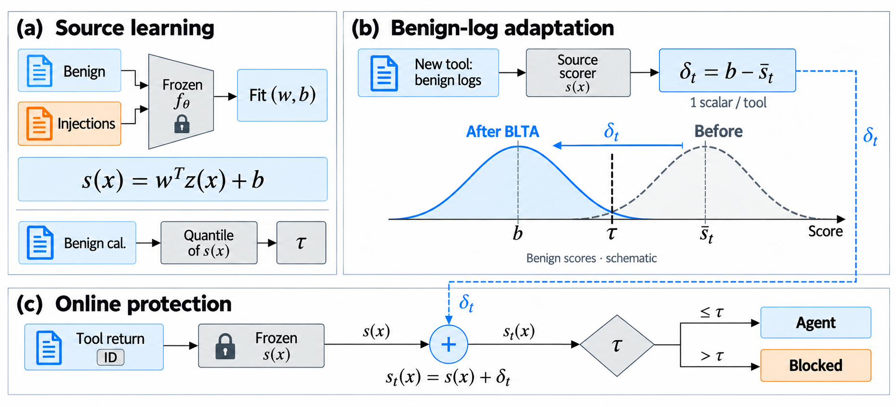

# BLTA: Benign-Log Tool Adaptation

**Adapt a frozen prompt-injection guard to a new tool using trusted benign logs.**

BLTA separates learning an injection direction from estimating a tool's benign
background. A balanced ridge readout learns from frozen source features. Trusted
benign observations from a new tool provide one scalar offset; the encoder,
source normalization, readout and source-calibrated threshold stay fixed.




## Quick start

Python 3.11 or newer; CPU only. The repository includes the cached inputs needed
for the commands below. No API key, GPU, PyTorch installation or model download
is needed for these reproduction runs.

```bash
git clone https://github.com/Tender221/BLTA.git
cd BLTA
python -m pip install -r requirements.txt
python reproduce.py --refit --output results
python -m unittest discover -s tests -v
```

The refit command trains all **90 source readouts**, recalculates cross-tool and
benign-log-budget results, and aggregates **2,688 recorded Agent task outcomes**.
It checks input hashes, source/target separation, telemetry selection, archived
parameters and exact FP/TP counts. A successful `results/verification.json` has
`archived_count_mismatches: 0` and
`source_or_target_partition_violations: 0`.

中文说明：[README_zh.md](README_zh.md)。

## Method

Given frozen features `h`, source-normal mean `mu` and scale `sigma`:

```text
z(x)   = (h(x) - mu) / sigma
s(x)   = w.T @ z(x) + b
delta  = b - mean(s(trusted_target_normals))
s_t(x) = s(x) + delta
block  = s_t(x) > source_threshold
```

Every observation from a tool receives the same offset. This changes its
operating point and preserves its within-tool score ranking. The trusted
executor supplies tool IDs; text inside an observation cannot select an offset.
Tools without a stored offset use the source score.

The portable implementation is [blta.py](blta.py):

```python
from blta import BLTA

# Each input is a 2-D matrix from the SAME frozen encoder and window rule.
guard = BLTA.fit(source_normal, source_attack, calibration_normal)
guard.adapt("new_tool", trusted_target_normal)
blocked = guard.blocked(test_features, ["new_tool"] * len(test_features))
```

The caller keeps source fitting, benign calibration, trusted target-normal
history and test observations separate. Calibration can yield an infinite
threshold if its sample size is too small for the requested nominal level; the
implementation retains that quantile result.

## Reproduced results

| Frozen encoder | Held-tool FPR before | BLTA FPR | BLTA TPR |
|---|---:|---:|---:|
| PIGuard | 8.28% | 3.86% | 98.12% |
| Wolf | 25.03% | 2.90% | 100.00% |
| ProtectAI v2 | 9.60% | 2.33% | 81.25% |

The table uses all available target-benign history and pools 5,750 benign and
960 attacked evaluations across five overlapping splits and six held tools.
These are evaluation counts across overlapping splits. Budget outputs separately
cover 8, 16, 32, 64, 128 and all available logs per tool.

## Outputs and repository map

| Path / output | Contents |
|---|---|
| `blta.py` | Source ridge fitting, benign adaptation, scoring and decisions |
| `reproduce.py` | CPU refit, partition checks and exact result reconstruction |
| `data/` | Derived simulator observations, frozen features, fold definitions and recorded task outcomes |
| `input_manifest.json` | Input checksums, upstream source hashes and recorded environment |
| `third_party/` | Pinned sources, model provenance and upstream license notices |
| `tests/` | Real archived-fold regression, portable replay and parameter validation |
| `results/cross_tool.csv` | Cross-tool FP/TP counts and rates |
| `results/telemetry.csv` | All log budgets and actual available-history sizes |
| `results/agent_main.csv` | Clean completion and controlled-goal ASR from recorded executions |
| `results/deployable_heads.json` | Verified readouts and per-tool offsets for each held-tool episode |

Different held-tool episodes have different source readouts. Select the matching
encoder, seed and held tool when loading a saved head.

This release covers the core BLTA mechanism and its main cached-input evaluation.
The Agent command reconstructs statistics from recorded executions; it does not
generate new model responses. Encoder extraction, final-block fine-tuning and
secondary experiments use the full research pipeline described in the manuscript.

## Sources, license and citation

The business observations derive from the pinned public simulator snapshot;
injection payloads derive from InjecAgent. Records, mock actions and canaries are
research fixtures. Base model weights are not included. Upstream sources retain
their own licenses; see [THIRD_PARTY.md](THIRD_PARTY.md).

The BLTA implementation is released under the [MIT License](LICENSE). Upstream
materials retain the licenses and attributions documented in
[THIRD_PARTY.md](THIRD_PARTY.md).

Use [CITATION.cff](CITATION.cff) to cite this research software. The accompanying
manuscript is **BLTA: Adapting Prompt-Injection Guards Across Tools with Benign
Logs**, by Enhui Wan and Xiaowan Wang; publication metadata will be added when
available.
